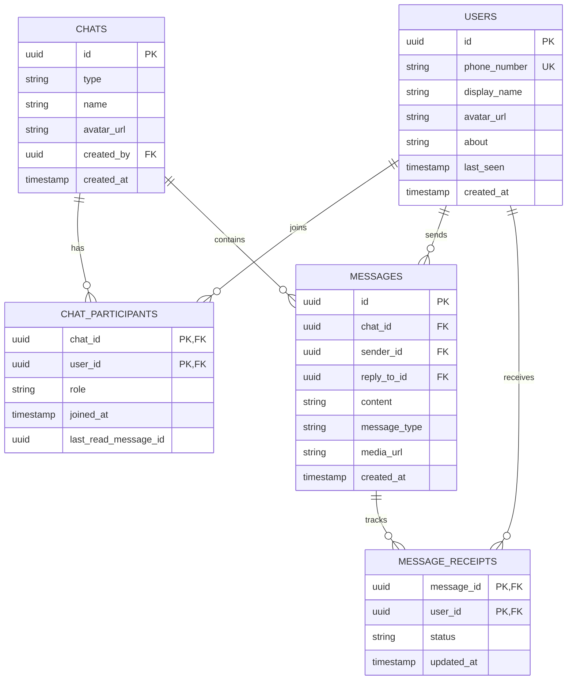

# WhatsApp database schema (Task 1)

## Relationships
- users and chats are many-to-many, resolved by the `chat_participants` junction table.
- chats to messages: one-to-many.
- users to messages: one-to-many (a user sends many messages).
- messages to message_receipts: one-to-many (one status per recipient, needed for groups).
- `messages.reply_to_id` points back to another message (reply feature).
